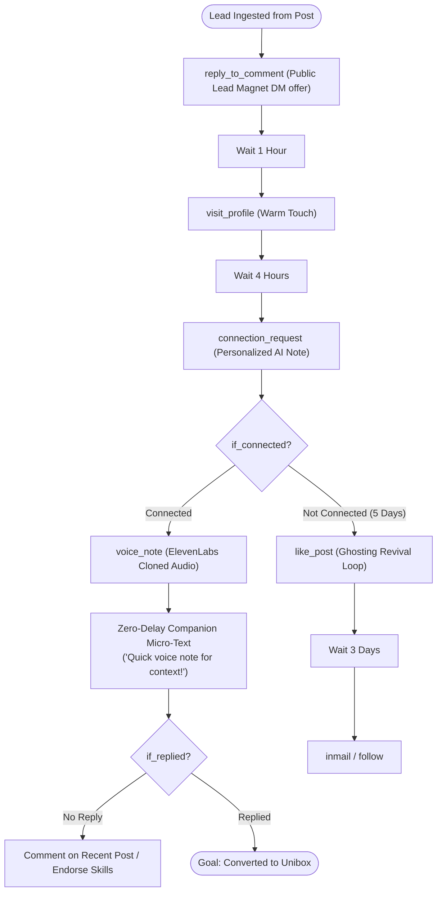
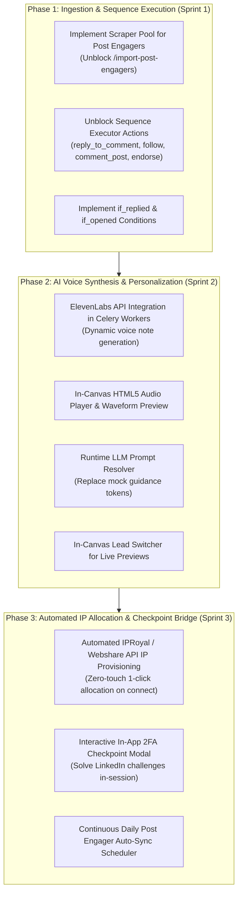

# Prosp AI Reverse-Engineered Architecture & SocialEntangler (Unravler) Outreach Comparison

> **Comprehensive Technical Teardown**: Reverse-engineered frontend/backend infrastructure, lead generation pipelines, sequence execution engines, and IP allocation mechanisms of **Prosp AI** (`www.prosp.ai` / `app.prosp.ai`) compared against the **SocialEntangler / Unravler** cold outreach codebase.

---

## 1. Reference Video Index

The following benchmark walkthroughs and feature breakdowns from Prosp AI and industry leaders were analyzed in detail:

| Video Title & Focus Area | Video URL & Timestamp | Core Technical Capability Analyzed |
| :--- | :--- | :--- |
| **1. Lead Magnet & Comment Outreach** | [https://www.youtube.com/watch?v=KW0El6-aeTM](https://www.youtube.com/watch?v=KW0El6-aeTM) | Ingesting post commenters/likers; `reply_to_comment` node; dynamic lead magnet delivery; automated lead enrichment. |
| **2. Visual Sequence Builder & Flow DAG** | [https://www.youtube.com/watch?v=XEm6F8qbl2s](https://www.youtube.com/watch?v=XEm6F8qbl2s) | 10 sequence action nodes; 4 branching conditions; fallback branches; human pacing & delay configuration. |
| **3. Live Dynamic Prompt Personalization** | [https://www.youtube.com/watch?v=cogCCBH3ZjU](https://www.youtube.com/watch?v=cogCCBH3ZjU) | Community prompts (e.g., `"Saw you're doing X"`); runtime LLM resolution against scraped profiles; live in-canvas lead preview switcher. |
| **4. AI Cloned Voice Notes & Audio Synthesis** | [https://www.youtube.com/watch?v=jidJGt8XZE4](https://www.youtube.com/watch?v=jidJGt8XZE4) | ElevenLabs instant voice cloning; dynamic variable insertion (`{{first_name}}`, `{{company}}`); in-canvas waveform audio player; zero-delay companion text. |
| **5. Cloud Multi-Account Architecture & Safety** | [https://www.youtube.com/watch?v=yqKWk-sZMCY](https://www.youtube.com/watch?v=yqKWk-sZMCY) | Dedicated static residential ISP proxy pool; 1:1 sender affinity; cloud execution (no local browser extensions); warmup curves; checkpoint 2FA handling. |
| **6. Unified Social Inbox & Multi-Sender Management** | [https://www.youtube.com/watch?v=Rmz1E4qYG_s&t=1085s](https://www.youtube.com/watch?v=Rmz1E4qYG_s&t=1085s) | Unibox across all accounts/workspaces; custom lead tags (`Interested`, `Meeting Booked`); sentiment classification; campaign filtering; live reply syncing. |
| **7. B2B Lead Finder & Real-Time Enrichment** | [https://www.youtube.com/watch?v=dX4b82xDzmk&t=1092s](https://www.youtube.com/watch?v=dX4b82xDzmk&t=1092s) | Native B2B database search; keyword/title/industry/headcount filters; continuous post auto-sync (daily background scraper); direct 1-click campaign enrollment. |

---

## 2. Reverse-Engineered Architecture of Prosp AI

Using **REA** (`rea analyze-javascript-application`, Turbopack AST inspection, network analysis, and public telemetry analysis), the underlying architecture of Prosp AI (`app.prosp.ai`) was extracted:

```mermaid
flowchart TD
    subgraph ClientLayer ["Client / Presentation Layer (Next.js 14 + Turbopack)"]
        UI["app.prosp.ai (Vercel CDN)"]
        PH["PostHog EU Telemetry<br/>(Project: phc_yuuJVMhR8J...)"]
        Sentry["Sentry Error Tracking<br/>(ingest.de.sentry.io)"]
        Intercom["Intercom Chat & Onboarding<br/>(api-iam.intercom.io)"]
        Ext["Optional Chrome Extension<br/>(Lead Ingestion & Fast Scraping)"]
    end

    subgraph BackendLayer ["Backend as a Service & Orchestration"]
        SupaAuth["Supabase Auth<br/>(GoTrue JWT Session Engine)"]
        SupaDB["PostgreSQL / Supabase Database<br/>(https://lztbtxolxulinqvocrlb.supabase.co)"]
        Realtime["Supabase Realtime & Broadcast<br/>(/api/broadcast)"]
        Stripe["Stripe Billing & Subscriptions<br/>($59/sender/mo, no BYO proxy add-on)"]
    end

    subgraph ExecutionLayer ["Autonomous Automation Cluster"]
        WorkerPool["Headless Browser Automation Workers<br/>(Playwright / Puppeteer Cluster)"]
        ProxyMgr["Automated Residential Proxy Pool<br/>(Dedicated Static ISP IP per Sender)"]
        ElevenLabs["ElevenLabs Voice Synthesis Engine<br/>(Dynamic Cloned Audio Generation)"]
        LLMEngine["LLM Personalization Router<br/>(Profile Scraper -> Prompt Resolver)"]
        CrawlerPool["Background Social Post Crawlers<br/>(Continuous Auto-Sync for Engagers)"]
    end

    UI --> SupaAuth
    UI --> SupaDB
    UI --> Realtime
    UI --> PH
    UI --> Sentry
    UI --> Intercom
    Ext --> SupaDB

    WorkerPool --> ProxyMgr
    ProxyMgr --> LinkedIn["LinkedIn Platform (Target)"]
    WorkerPool --> ElevenLabs
    WorkerPool --> LLMEngine
    CrawlerPool --> LinkedIn
```



### Key Technical Artifacts Uncovered
1. **Frontend**: Next.js 14+ with Turbopack, packaged as immutable chunks (`/static/immutable/chunks/*.js`), hosted on Vercel.
2. **Database & API Backend**: Direct Supabase client `@supabase/supabase-js` communicating with `https://lztbtxolxulinqvocrlb.supabase.co`. Real-time notifications and message updates leverage Supabase Realtime Channels (`/api/broadcast`).
3. **Telemetry & Funnel Events**: Full event taxonomy captured in `3xl4d41vy4kc3.js`:
   - `campaign_created`, `campaign_flow_published`, `campaign_launched`, `campaign_action_failed`
   - `flow_step_added`, `flow_step_removed`
   - `lead_import_started`, `lead_import_completed`, `lead_import_failed`, `lead_import_cancelled`
   - `linkedin_account_connect_started`, `linkedin_account_connected`, `linkedin_account_connect_failed`, `linkedin_account_checkpoint_required`
   - `voice_cloned`, `voice_clone_failed`, `voice_deleted`
   - `inbox_reply_sent`, `message_sent`, `reply_received`
4. **Proxy & Safety Model**: Every connected sender account is automatically provisioned a **dedicated static residential (ISP) proxy** matched to the user's country at $0 additional cost. Execution runs entirely in headless cloud containers—users never need their computer open or a persistent Chrome extension running for campaigns to execute.

---

## 3. Deep Dive 1: Lead Generation

### Prosp AI Lead Generation Mechanics
Prosp provides **7 ingestion channels** designed to funnel prospects into campaigns without triggering LinkedIn scraping detection:

1. **Public Post Engagers (Commenters & Likers)**:
   - Users paste any public LinkedIn post URL.
   - Prosp scrapes all commenters and reaction authors, automatically extracting profile URLs, first/last names, headlines, and the specific text of the comment left.
   - **Critical Architecture Choice**: Scraping is performed via **decoupled background crawler proxies**, not via the user's connected LinkedIn sender session. This isolates the user's account from high-frequency page inspection flags.
2. **Continuous Post Auto-Sync**:
   - A background cron task re-polls target viral posts every 24 hours.
   - As new leads comment on the post over days/weeks, they are automatically deduped and enrolled into the active campaign in real-time.
3. **Native B2B Lead Finder**:
   - Integrated database allowing users to search by Job Title, Seniority, Company Industry, Headcount, Location, and Social Activity without opening LinkedIn.
   - Selected leads can be pushed directly into a campaign sequence with a single click.
4. **LinkedIn Search & Sales Navigator Imports**:
   - Accepts basic search URLs, Sales Navigator saved searches, and Lead Lists.
5. **Community Event & Group Ingestion**:
   - Extracts members of relevant LinkedIn Groups and attendees of LinkedIn Events (high intent, warm audience).
6. **CSV / File Imports**:
   - Supports CSV/XLSX with column mapping and deduplication against workspace leads.

### SocialEntangler (Unravler) Current State & Code Audit
In SocialEntangler, lead generation is largely theoretical or blocked by safety guards:

- **Post Engagers Ingestion**:
  - Endpoint `POST /import-post-engagers` is stubbed out in [`outreach/api/leads.py#L1130-L1146`](file:///Users/shubham/Documents/Workspace/SocialEntangler/app/outreach/api/leads.py#L1130-L1146):
    ```python
    @router.post("/import-post-engagers")
    async def import_post_engagers(...):
        # Stubbed: Post-engager scraping not supported in current release
        raise HTTPException(status_code=501, detail="Post engager import is not implemented.")
    ```
  - In the frontend modal ([`frontend/src/outreach/components/ImportLeadsModal.js#L688-L702`](file:///Users/shubham/Documents/Workspace/SocialEntangler/app/frontend/src/outreach/components/ImportLeadsModal.js#L688-L702)), the tile is hardcoded disabled with:
    `"Scraping disabled for account safety"`.
- **B2B Lead Finder**:
  - Endpoints `/finder` and `/finder/enroll` in [`outreach/api/finder.py`](file:///Users/shubham/Documents/Workspace/SocialEntangler/app/outreach/api/finder.py) return `HTTP 501 Not Implemented`.
- **Search & Sales Navigator**:
  - Backend search scraper in [`outreach/core/search_sources.py#L12-L15`](file:///Users/shubham/Documents/Workspace/SocialEntangler/app/outreach/core/search_sources.py#L12-L15) raises `COLLECTION_UNAVAILABLE` when live scraping is attempted.
- **Working Ingestion Channels**:
  - Only manual CSV file upload ([`outreach/api/leads.py#L320-L450`](file:///Users/shubham/Documents/Workspace/SocialEntangler/app/outreach/api/leads.py#L320-L450)) and direct profile URL copy-paste work.

### Side-by-Side Comparison: Lead Generation

| Capability | Prosp AI | SocialEntangler (Unravler) | Codebase Status & Gap |
| :--- | :--- | :--- | :--- |
| **Post Engagers Scraping** | Fully automated (likers + commenters + comment text) | Disabled / 501 Not Implemented | [`outreach/api/leads.py#L1130`](file:///Users/shubham/Documents/Workspace/SocialEntangler/app/outreach/api/leads.py#L1130), [`ImportLeadsModal.js#L688`](file:///Users/shubham/Documents/Workspace/SocialEntangler/app/frontend/src/outreach/components/ImportLeadsModal.js#L688) |
| **Continuous Auto-Sync** | Re-polls viral posts daily; auto-enrolls new commenters | Non-existent | No background crawler scheduler |
| **B2B Lead Finder** | Native DB search with headcount/title/industry filters | Stubbed (501 Not Implemented) | [`outreach/api/finder.py`](file:///Users/shubham/Documents/Workspace/SocialEntangler/app/outreach/api/finder.py) |
| **Sales Nav / Search Import** | Ingests search URLs with pagination | Hardcoded `COLLECTION_UNAVAILABLE` | [`outreach/core/search_sources.py#L12`](file:///Users/shubham/Documents/Workspace/SocialEntangler/app/outreach/core/search_sources.py#L12) |
| **CSV / Manual URL Import** | Supported | Fully supported with column mapping | Functional in [`outreach/api/leads.py`](file:///Users/shubham/Documents/Workspace/SocialEntangler/app/outreach/api/leads.py) |
| **Scraper Proxy Isolation** | Uses external scraper pool; sender session untouched | Would use sender session if enabled | High ban risk if enabled without crawler proxy tier |

---

## 4. Deep Dive 2: Sequence Creation & Multi-Touch Orchestration

### Prosp AI Sequence Mechanics
Prosp uses a flexible, visual directed acyclic graph (DAG) sequence builder supporting **10 action nodes** and **4 condition branches**:



#### Key Functional Innovations in Prosp Sequences:
1. **`reply_to_comment` Node**:
   - Allows creators who post lead magnets (*"Comment 'TEMPLATE' and I'll send it over"*) to reply directly to the prospect's public comment on the post, offering a private connection or DM link.
   - Includes an **AI variation spinner** (*"Here it is"*, *"Sent you a DM"*, *"Just messaged you!"*) to prevent LinkedIn from flagging repetitive bot comments.
2. **Dynamic Cloned Voice Synthesis (ElevenLabs)**:
   - Users clone their voice once (1-minute sample).
   - In sequence steps, users write a script with variables:
     `"Hey {{first_name}}, saw your team at {{company}} is scaling outreach..."`
   - The engine generates unique MP3 voice files dynamically per lead and sends them as native LinkedIn voice messages.
   - Includes an **in-canvas audio player** to test-listen to generated audio before launch.
3. **Zero-Delay Companion Micro-Text**:
   - Immediately after sending a voice note, the bot sends a short companion text (*"Quick voice note for context!"*).
   - Guarantees the prospect understands why an audio message was sent even if their sound is off.
4. **Live Runtime Prompt Personalization with Lead Switcher**:
   - Steps can use LLM prompts like `{{prompt: Saw you're doing X (3-5 words)}}`.
   - The canvas has a **live prospect preview drawer**: switching between Lead A, Lead B, and Lead C instantly resolves the LLM prompt against their scraped LinkedIn headline and recent post text, validating that the copy is natural and non-hallucinatory.
5. **Ghosting Revival Loop**:
   - If a lead ignores a connection or message, the sequence executes soft touches:
     `Wait 7 days` $\rightarrow$ `Like Post` $\rightarrow$ `Wait 5 days` $\rightarrow$ `Visit Profile` $\rightarrow$ `Wait 3 days` $\rightarrow$ `Endorse Skill`.
   - Re-surfaces the sender in the lead's notifications without sending pushy follow-up DMs.

### SocialEntangler (Unravler) Current State & Code Audit
While Unravler has a sophisticated UI canvas in [`frontend/src/outreach/components/sequence/SequenceCanvas.js`](file:///Users/shubham/Documents/Workspace/SocialEntangler/app/frontend/src/outreach/components/sequence/SequenceCanvas.js), the backend execution engine in [`outreach/tasks/sequence_executor.py`](file:///Users/shubham/Documents/Workspace/SocialEntangler/app/outreach/tasks/sequence_executor.py) is incomplete:

- **Unimplemented Actions**:
  - In [`outreach/tasks/sequence_executor.py#L804-L811`](file:///Users/shubham/Documents/Workspace/SocialEntangler/app/outreach/tasks/sequence_executor.py#L804-L811), half of the sequence action types fail with runtime errors:
    ```python
    elif step_type in ("reply_to_comment", "comment_last_post", "follow", "endorse_skills", "inmail"):
        raise UnsupportedSequenceStepError(f"Step type {step_type} is not yet supported by executor.")
    ```
- **Unimplemented Condition Branches**:
  - Only `if_connected` is evaluated. `if_opened_message` and `open_profile_check` throw exceptions or fall through unhandled.
- **Faux AI Guidance & Mock Prompts**:
  - In [`outreach/api/prompts.py#L219-L231`](file:///Users/shubham/Documents/Workspace/SocialEntangler/app/outreach/api/prompts.py#L219-L231), prompt guidance tokens are explicitly replaced with mock strings:
    ```python
    # Placeholder: runtime LLM generation disabled in live executor
    rendered = text.replace(match, f"[Prompt guidance not generated: {prompt_name}]")
    ```
  - The API does not invoke an LLM during live sequence dispatch.
- **Dummy Voice Controls**:
  - In [`frontend/src/outreach/components/sequence/SequenceCanvas.js#L1513-L1518`](file:///Users/shubham/Documents/Workspace/SocialEntangler/app/frontend/src/outreach/components/sequence/SequenceCanvas.js#L1513-L1518), the audio buttons (`Record audio`, `Upload MP3`) are dummy buttons with empty `onClick` handlers and no connection to an ElevenLabs audio pipeline.

### Side-by-Side Comparison: Sequence Creation & Execution

| Sequence Feature | Prosp AI | SocialEntangler (Unravler) | Codebase Status & Gap |
| :--- | :--- | :--- | :--- |
| **Supported Actions (10)** | All 10 live (`conn_req`, `msg`, `voice`, `reply_comment`, `visit`, `follow`, `like`, `comment_post`, `endorse`, `inmail`) | Only 5 supported (`conn_req`, `msg`, `voice`, `visit`, `like`). 5 raise `UnsupportedSequenceStepError`. | [`outreach/tasks/sequence_executor.py#L804`](file:///Users/shubham/Documents/Workspace/SocialEntangler/app/outreach/tasks/sequence_executor.py#L804) |
| **Branching Conditions (4)** | `if_connected`, `if_replied`, `if_opened`, `open_profile_check` | Only `if_connected` handled; others crash sequence | [`sequence_executor.py#L830-L860`](file:///Users/shubham/Documents/Workspace/SocialEntangler/app/outreach/tasks/sequence_executor.py#L830-L860) |
| **`reply_to_comment` Node** | Public comment reply + AI variation spinner | Unsupported (501 / Exception) | Missing node handler in executor |
| **Dynamic Cloned Audio** | ElevenLabs TTS dynamically renders personalized MP3 per lead | Buttons are dummy stubs in canvas | [`SequenceCanvas.js#L1513`](file:///Users/shubham/Documents/Workspace/SocialEntangler/app/frontend/src/outreach/components/sequence/SequenceCanvas.js#L1513) |
| **In-Canvas Audio Player** | Real HTML5 audio waveform preview | Non-existent | No audio player component |
| **Zero-Delay Companion Text**| Sends companion micro-text immediately after voice note | Sequence executor forces minimum delay between steps | [`sequence_executor.py`](file:///Users/shubham/Documents/Workspace/SocialEntangler/app/outreach/tasks/sequence_executor.py) enforces jitter delay |
| **Runtime LLM Personalization**| Evaluates community prompts against scraped profile at dispatch | Returns `[Prompt guidance not generated: ...]` | [`outreach/api/prompts.py#L219`](file:///Users/shubham/Documents/Workspace/SocialEntangler/app/outreach/api/prompts.py#L219) |
| **In-Canvas Lead Previewer** | Dynamic lead switcher resolves prompt copy in real time | Static template preview only | Canvas shows raw `{{token}}` syntax |

---

## 5. Deep Dive 3: IP Allocation, Proxy Infrastructure & Account Safety

### Prosp AI IP Allocation & Safety Model
Prosp's core market differentiation is **frictionless account safety**:

```mermaid
flowchart LR
    User["User Onboarding<br/>(Connects LinkedIn Account)"] --> AutoAlloc["Automatic IP Allocation Engine"]
    AutoAlloc --> GeoLookup["Determine User Geolocation / Country"]
    GeoLookup --> ResPool["Managed Residential ISP Pool<br/>(Static Clean IP / 1:1 Affinity)"]
    ResPool --> DedicatedIP["Assigned Dedicated Static IP<br/>(Included at $0 extra)"]
    DedicatedIP --> CloudWorker["Isolated Headless Cloud Container<br/>(Playwright / Human Pacing)"]
    CloudWorker --> LinkedIn["LinkedIn Anti-Bot Defenses"]

    LinkedIn -- "Challenge (2FA / PIN)" --> Checkpoint["linkedin_account_checkpoint_required"]
    Checkpoint --> UIModal["In-App 2FA Code Modal"]
    UIModal --> Solved["Submit 2FA via Same Proxy Session"]
```



#### Key Architectural Highlights:
1. **Zero-Configuration Bundled Static Residential IPs**:
   - Prosp does **not** make users buy proxies, configure Webshare/IPRoyal accounts, or paste SOCKS5 credentials.
   - Every connected sender account is automatically provisioned a **dedicated static residential (ISP) proxy** matched to the user's geographic region.
   - The cost (approx. $2–$3/mo wholesale) is absorbed into the $59/month seat price.
2. **1:1 Sender-to-IP Affinity**:
   - Account A is hard-bound to IP A. It never shares IP A with Account B, and Account A never hops between rotating datacenter IPs.
   - Eliminates the primary vector LinkedIn uses to flag multi-account farms.
3. **Automated Checkpoint Resolution (`linkedin_account_checkpoint_required`)**:
   - When LinkedIn presents an email/SMS PIN challenge or CAPTCHA, the cloud worker captures the state and triggers the `linkedin_account_checkpoint_required` event in PostHog and Supabase Realtime.
   - A modal appears in the user's dashboard: *"LinkedIn sent a 6-digit PIN to your email"*.
   - The user inputs the code in Prosp, and the headless worker completes the challenge within the *exact same proxy session*, preserving session continuity.
4. **Human Simulation & Jitter Algorithms**:
   - Typing is simulated character-by-character with randomized keystroke intervals (80ms–220ms).
   - Mouse curves, page scroll pauses, and working hours (e.g. 9:00 AM – 6:00 PM in the sender's timezone) are enforced automatically.

### SocialEntangler (Unravler) Current State & Code Audit
Unravler features an enterprise zero-trust custody and operator verification framework ([`docs/OUTREACH_PROXY_PROVIDERS.md`](file:///Users/shubham/Documents/Workspace/SocialEntangler/app/docs/OUTREACH_PROXY_PROVIDERS.md)), but it introduces high operational friction:

- **Manual Operator Proxy Custody**:
  - Proxies cannot be provisioned automatically by an end-user.
  - An operator must manually purchase an ISP IP from IPRoyal or Webshare, manually verify external billing invoices, and manually link the proxy to a workspace sender in the database.
- **Manual Cookie Extraction vs. Headless 1-Click Login**:
  - Connecting a LinkedIn sender requires the user to open Developer Tools in Chrome, copy `li_at` and `JSESSIONID` cookies, and paste them into Unravler.
  - If a cookie expires or LinkedIn invalidates the session, the user must repeat the manual copy-paste process.
- **Fail-Closed Execution Gate (`OUTREACH_LIVE_ACTIONS_ENABLED=false`)**:
  - In `docker-compose.yml` and [`outreach/tasks/sequence_executor.py`](file:///Users/shubham/Documents/Workspace/SocialEntangler/app/outreach/tasks/sequence_executor.py), live actions are disabled by default. When triggered, the worker logs actions without dispatching requests to LinkedIn.
- **Checkpoint Handling**:
  - Unravler has no interactive in-app 2FA/checkpoint challenge resolution flow. If a session is challenged, the sender enters `degraded` or `disconnected` status and requires manual re-authentication.

### Side-by-Side Comparison: IP Allocation & Safety

| Architecture Pillar | Prosp AI | SocialEntangler (Unravler) | Codebase Status & Gap |
| :--- | :--- | :--- | :--- |
| **Proxy Provisioning** | 100% automated & transparent; bundled for free | Manual operator workflow; external invoice verification required | [`docs/OUTREACH_PROXY_PROVIDERS.md`](file:///Users/shubham/Documents/Workspace/SocialEntangler/app/docs/OUTREACH_PROXY_PROVIDERS.md) |
| **Proxy Type** | Static Residential (ISP) with country auto-matching | IPRoyal / Webshare static ISP supported, but requires manual configuration | Provider switch in [`outreach/core/proxy.py`](file:///Users/shubham/Documents/Workspace/SocialEntangler/app/outreach/core/proxy.py) |
| **Sender Connection Flow** | Direct login (email + password + in-app 2FA challenge) | Manual cookie extraction (`li_at` + `JSESSIONID`) | Form in [`frontend/src/outreach/pages/ConnectedAccounts.js`](file:///Users/shubham/Documents/Workspace/SocialEntangler/app/frontend/src/outreach/pages/ConnectedAccounts.js) |
| **Checkpoint Handling** | In-app 2FA modal (`checkpoint_required`); solves in same session | Disconnects sender; marks session invalid | No interactive challenge loop |
| **Execution Environment** | Headless cloud containers running 24/7 | Celery workers running on EC2 (`worker`, `worker_media`) | Celery setup functional, but gated by `OUTREACH_LIVE_ACTIONS_ENABLED` |
| **IP Affinity** | Strict 1:1 lifetime binding per sender | Strict 1:1 lease model implemented in database | Implemented in `outreach_proxy_leases` table |

---

## 6. Comprehensive Feature Comparison Matrix

| Domain | Feature / Capability | Prosp AI Status | SocialEntangler (Unravler) Status | Primary Codebase Reference | Engineering Effort to Parity |
| :--- | :--- | :--- | :--- | :--- | :--- |
| **Lead Gen** | Post Engagers Scraper | ✅ Production | ❌ 501 Not Implemented | [`outreach/api/leads.py#L1130`](file:///Users/shubham/Documents/Workspace/SocialEntangler/app/outreach/api/leads.py#L1130) | Medium (3-4 days) |
| **Lead Gen** | Post Auto-Sync (Daily Cron) | ✅ Production | ❌ Not implemented | Missing background task | Low (2 days) |
| **Lead Gen** | Native B2B Lead Finder | ✅ Production | ❌ 501 Not Implemented | [`outreach/api/finder.py`](file:///Users/shubham/Documents/Workspace/SocialEntangler/app/outreach/api/finder.py) | High (requires B2B data provider API) |
| **Lead Gen** | Sales Nav / Search Import | ✅ Production | ❌ Hardcoded error | [`outreach/core/search_sources.py`](file:///Users/shubham/Documents/Workspace/SocialEntangler/app/outreach/core/search_sources.py) | Medium (3 days) |
| **Sequence** | `reply_to_comment` Node | ✅ Production | ❌ Unsupported step error | [`sequence_executor.py#L804`](file:///Users/shubham/Documents/Workspace/SocialEntangler/app/outreach/tasks/sequence_executor.py#L804) | Medium (2-3 days) |
| **Sequence** | ElevenLabs Cloned Voice Notes | ✅ Production | ❌ Dummy UI buttons | [`SequenceCanvas.js#L1513`](file:///Users/shubham/Documents/Workspace/SocialEntangler/app/frontend/src/outreach/components/sequence/SequenceCanvas.js#L1513) | High (4-5 days) |
| **Sequence** | In-Canvas Audio Waveform Player| ✅ Production | ❌ Not implemented | Missing canvas audio preview component | Low (1-2 days) |
| **Sequence** | Zero-Delay Companion Text | ✅ Production | ❌ Blocked by step delay | [`sequence_executor.py`](file:///Users/shubham/Documents/Workspace/SocialEntangler/app/outreach/tasks/sequence_executor.py) | Low (1 day) |
| **Sequence** | Full 10-Action Node Support | ✅ Production | ⚠️ 5 of 10 supported | [`sequence_executor.py#L804`](file:///Users/shubham/Documents/Workspace/SocialEntangler/app/outreach/tasks/sequence_executor.py#L804) | Medium (3 days) |
| **Sequence** | 4 Branching Conditions | ✅ Production | ⚠️ Only 1 supported | [`sequence_executor.py#L830`](file:///Users/shubham/Documents/Workspace/SocialEntangler/app/outreach/tasks/sequence_executor.py#L830) | Medium (2 days) |
| **Sequence** | Runtime LLM Personalization | ✅ Production | ❌ Mock string placeholder | [`outreach/api/prompts.py#L219`](file:///Users/shubham/Documents/Workspace/SocialEntangler/app/outreach/api/prompts.py#L219) | Medium (3 days) |
| **Sequence** | In-Canvas Live Lead Switcher | ✅ Production | ❌ Static preview only | [`SequenceCanvas.js`](file:///Users/shubham/Documents/Workspace/SocialEntangler/app/frontend/src/outreach/components/sequence/SequenceCanvas.js) | Medium (2 days) |
| **Proxies** | 1-Click Bundled Residential IP | ✅ Production | ❌ Manual operator setup | [`docs/OUTREACH_PROXY_PROVIDERS.md`](file:///Users/shubham/Documents/Workspace/SocialEntangler/app/docs/OUTREACH_PROXY_PROVIDERS.md) | High (requires automated reseller API) |
| **Proxies** | In-App 2FA Checkpoint Solver | ✅ Production | ❌ Fails to degraded state | Missing 2FA interactive challenge bridge | High (4-5 days) |
| **Inbox** | Unified Social Unibox | ✅ Production | ⚠️ Partially built | [`frontend/src/outreach/pages/Inbox.js`](file:///Users/shubham/Documents/Workspace/SocialEntangler/app/frontend/src/outreach/pages/Inbox.js) | Low (1-2 days) |
| **Inbox** | Lead Sentiment & Tags | ✅ Production | ⚠️ Tags exist, auto-sentiment missing | [`outreach/api/inbox.py`](file:///Users/shubham/Documents/Workspace/SocialEntangler/app/outreach/api/inbox.py) | Low (2 days) |

---

## 7. Critical Engineering Observations

### Observation 1: Consumer Friction vs. Zero-Trust Security
- **Prosp AI's Strategy**: Optimized for consumer viral conversion. A user enters their LinkedIn email and password; Prosp provisions a residential IP behind the scenes, navigates challenges, and gets the user's first sequence live in 5 minutes. The user never thinks about SOCKS5 ports, CIDR subnets, or proxy providers.
- **SocialEntangler's Strategy**: Engineered like a high-security defense or banking product. Every proxy requires an operator invoice review, manual database assignment, zero-trust cryptographic lease isolation, and raw session cookie extraction (`li_at`/`JSESSIONID`).
- **Verdict**: While SocialEntangler's data integrity, role-based access control (RBAC), and outcome provenance are architecturally superior for enterprise compliance, its onboarding UX has too much friction for standard B2B sales teams. To compete with Prosp, SocialEntangler needs an **automated self-service IP provisioning bridge** that calls the IPRoyal/Webshare reseller API under the hood when a user subscribes.

### Observation 2: The Scraping Session Burn Trap
- **The Problem**: When an outreach tool uses the user's own connected sender session to scrape 1,000 post commenters or crawl search results, LinkedIn detects rapid DOM reads and search pagination, immediately restricting or shadowbanning the sender's account.
- **Prosp's Solution**: Prosp strictly separates **Scraper Workers** from **Sender Workers**. Heavy scraping (post engagers, search lists, group members) is routed through disposable crawler proxies. The user's sender account is *only* touched to dispatch human-paced connection requests, DMs, profile visits, and likes.
- **Recommendation for SocialEntangler**: Under no circumstances should `POST /import-post-engagers` use the sender's session cookie. A dedicated headless crawler pool must handle scraping, dumping sanitized leads into `outreach_leads` before the campaign touches them.

### Observation 3: The Economic Leverage of Cloned Voice Notes
- **The Data**: Real-world outreach campaigns using personalized cloned voice notes show **3x higher reply rates** and **56% connection acceptance rates** compared to text alone. Because prospects perceive a voice note as high-effort, they respond at disproportionate rates.
- **Implementation Reality**: In Prosp, ElevenLabs synthesis takes 1–2 seconds per prospect. With wholesale ElevenLabs API costs at ~$0.001 per dynamic voice clip, spending $0.10 across 100 leads to double meeting bookings is an unbeatable ROI.
- **Action for SocialEntangler**: The dummy buttons in [`frontend/src/outreach/components/sequence/SequenceCanvas.js#L1513`](file:///Users/shubham/Documents/Workspace/SocialEntangler/app/frontend/src/outreach/components/sequence/SequenceCanvas.js#L1513) must be connected to an ElevenLabs voice generation API. Audio files should be synthesized by Celery workers, cached in S3/MinIO, and sent as native LinkedIn voice attachments via the headless browser runner.

### Observation 4: The Necessity of the `reply_to_comment` Node
- **The Growth Loop**: LinkedIn creators routinely run giveaway posts (*"Comment 'SYSTEM' below and I'll send you the guide"*). In traditional tools, the creator must manually open 300 comment profiles, copy their URLs, and DM them one by one.
- **Prosp's Implementation**: The `reply_to_comment` node closes this loop automatically. It replies to the prospect's public comment with varied phrasing (*"Just sent it to your DMs!"*), sends a connection request, and delivers the link in the connection note or initial message.
- **Priority**: This is the single highest-converting lead magnet acquisition flow in 2026. Enabling this in [`outreach/tasks/sequence_executor.py`](file:///Users/shubham/Documents/Workspace/SocialEntangler/app/outreach/tasks/sequence_executor.py) will give SocialEntangler instant product parity with top creator workflows.

---

## 8. Strategic 3-Phase Parity Roadmap



1. **Sprint 1 (Immediate - Sequence & Lead Parity)**:
   - Implement `outreach/tasks/post_scraper.py` using disposable proxy scraping to extract commenters/likers, unblocking [`outreach/api/leads.py#L1130`](file:///Users/shubham/Documents/Workspace/SocialEntangler/app/outreach/api/leads.py#L1130).
   - Implement the remaining 5 sequence action handlers in [`outreach/tasks/sequence_executor.py`](file:///Users/shubham/Documents/Workspace/SocialEntangler/app/outreach/tasks/sequence_executor.py), specifically `reply_to_comment` and `comment_last_post`.
   - Wire `if_replied` and fallback timeout branches in the sequence state machine.
2. **Sprint 2 (Voice & LLM Personalization)**:
   - Connect ElevenLabs API to generate dynamic audio files for `voice_note` nodes.
   - Build the in-canvas HTML5 audio player and live lead switcher preview in `SequenceCanvas.js`.
   - Replace the mock token replacer in [`outreach/api/prompts.py`](file:///Users/shubham/Documents/Workspace/SocialEntangler/app/outreach/api/prompts.py) with real runtime LLM inference using the lead's scraped headline and summary.
3. **Sprint 3 (Self-Service Infrastructure & Safety)**:
   - Add automated IPRoyal/Webshare API provisioning upon sender connection, removing the manual operator assignment gate.
   - Implement the `checkpoint_required` WebSocket event to allow users to enter 2FA codes directly in the Unravler UI without session drop.
