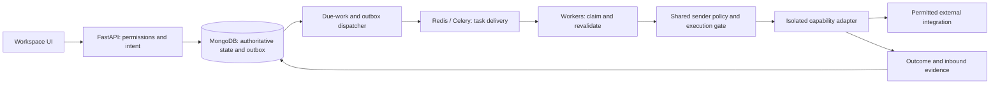

# Unravler.io architecture review

Review of the three supplied version 2.0.0 documents. This is an architectural assessment and proposed implementation baseline, not certification of the current code or deployment.

## Recommendation

Keep the product direction and the FastAPI, MongoDB, Redis, Celery, and React stack. Revise the specifications before using them as the implementation source of truth. The strongest ideas are staged ingestion, explicit entitlement checks, durable scheduling, human review, sender-bound proxy assignments, and preserving uncertain action outcomes. The most serious problems are unsupported implementation labels, overstated external guarantees, conflated lifecycle states, and incomplete handling of concurrent execution and recovery.

Continue useful development on imports, drafts, review, reporting, and operational controls. Hold customer-facing live LinkedIn execution behind its existing gate until the access model and the release criteria below are resolved. Customer consent and engineering controls do not establish platform authorization.

## Scope and evidence

The complete contents of these files were reviewed:

- **D1:** [User Lifecycle and IP Provisioning](</Users/shubham/Desktop/Unravler/Unravler.io Docs/DOC_1_USER_LIFECYCLE_AND_IP_PROVISIONING.md>).
- **D2:** [Feature Catalog and Capabilities](</Users/shubham/Desktop/Unravler/Unravler.io Docs/DOC_2_FEATURE_CATALOG_AND_CAPABILITIES.md>).
- **D3:** [System Design and Architecture](</Users/shubham/Desktop/Unravler/Unravler.io Docs/DOC_3_SYSTEM_DESIGN_AND_ARCHITECTURE.md>).

Line numbers below refer to those supplied files. Provider and infrastructure claims were checked against the primary documentation linked beside the relevant finding. Proposed mechanisms and thresholds are engineering recommendations, not statements that they already exist.

The repository session memory reports a manual, invoice-verified pilot, managed IPRoyal inventory, disabled live actions, and automated test results. This review uses that record only to identify claims requiring verification. Application files, tests, production configuration, and purchased provider inventory have not been audited as part of this review. The original three documents and application code are unchanged.

Priority definitions:

- **P0:** Correct before accepting the documents as the build baseline or enabling the affected live capability.
- **P1:** Specify and verify before expanding the pilot.
- **P2:** Add when measured demand or operational cost justifies the capability.

## 1. P0 — Establish an evidence-backed implementation baseline

**References:** All status legends; D1 lines 36–59, 85–104, 163–195; D2 lines 108–140, 160, 185–191; D3 lines 203–263.

The implementation labels combine different kinds of evidence and sometimes contradict the same document. D1 marks the seat state table implemented and tested even though its Stripe-driven provisioning flow is planned later. D2 marks AI personalization and prompt-injection defense implemented while explicitly marking the defense planned. D3 labels the canonical action and seat schemas implemented without a code location, migration, deployed revision, or test reference.

There are also conflicts with the recorded pilot: automatic purchase and subscription billing appear as built behavior, while the session record describes manual purchasing and operator-granted access. Engage warm-up is marked planned despite the record describing a built, disabled capability. These are discrepancies to investigate, not proof that the application is missing those features.

**Change:** Give each independently testable capability a row with requirement ID, specification version, implementation state, activation flag, environment, code/commit references, test evidence, live verification evidence, and last verification time. Until checked, existing implemented claims should be recorded as **reported implemented; verification pending**. A disabled feature can be implemented and tested. Mocked tests can verify local behavior without proving a provider integration works.

**Acceptance:** Every shipped claim resolves to evidence at a named revision; planned behavior is separate from the current pilot; no automated test label is presented as live verification.

## 2. P0 — Make the LinkedIn access model an explicit architecture decision

**References:** D1 lines 16–30; D2 lines 47–57, 88–98, 185–197; D3 lines 18–27.

The design depends on a private API whose use is outside the platform's published integration contract. LinkedIn expressly prohibits unauthorized crawling and automation and warns of restriction and tool interruption. Owning an account, obtaining the account owner's consent, or completing a canary period does not remove that dependency risk. [LinkedIn prohibited software policy](https://www.linkedin.com/help/linkedin/answer/a1341387/prohibited-software-and-extensions).

**Change:** Add a decision record identifying the permitted access route and supported actions. Treat authorized integrations and manual workflows as explicit product modes. Any proposal relying on unofficial execution needs a separately recorded product/legal decision and must remain gated; disclosure is one requirement, not the entire decision.

Keep the transport adapter replaceable and keep business logic independent of private endpoint shapes. Do not invest in more automated actions before validating the access route. Do not treat fake accounts or manufactured engagement as a valid canary strategy.

**Acceptance:** Every externally executed action has a named access route, accountable owner, enablement decision, and supported evidence contract. A failed decision still leaves imports from permitted sources, drafts, review, and reporting usable.

## 3. P0 — Replace the false at-most-once guarantee with a complete execution protocol

**References:** D1 lines 186–195; D3 lines 132–143, 230–242.

A compound unique index prevents duplicate logical records. It does not guarantee at-most-once external execution. Two workers can obtain the same existing record and both send. More fundamentally, a remote service can accept an action before the worker crashes, leaving no local confirmation. Fencing tokens prevent stale conditional database writes; the external service must participate for them to fence its side effects.

**Change:** Separate a logical action from its individual attempts. Define a durable intent, atomic claim, owner token, claim expiry, sender execution lease, attempt record, immediate pre-dispatch validation, and conditional finalization. Use an outbox written atomically with the state transition, then publish to Celery with safe duplicate consumption. MongoDB is the source of intent; the broker is a delivery mechanism.

The logical key should include tenant identity and enrollment/sequence revision semantics. For example, `(workspace_id, enrollment_id, sequence_version, node_id, action_kind)` is a candidate, subject to the re-enrollment policy. Never use an attempt ID as the logical deduplication key.

If a possibly submitted action lacks reliable evidence, preserve `unknown_outcome` and block automatic redispatch. Reconciliation must be able to return unresolved. A successful read with no visible result may not prove the original action never happened. An in-flight claim expiring must not itself authorize another send.

**Acceptance:** Duplicate broker deliveries, worker crashes before and after remote acceptance, expired claims, and stale worker completion cannot create an automatic second uncertain send. The specification states the limits of external guarantees.

## 4. P0 — Separate entitlement, subscription, provisioning, proxy assignment, and sender health

**References:** D1 lines 36–59, 93–104, 141–154; D3 lines 112–117, 219–224, 244–263.

The seat state mixes billing, connectivity, and restriction conditions. A seat can be paid while its sender needs reauthentication; a subscription can be scheduled to cancel while access remains paid; an upstream proxy can expire while the customer subscription remains valid. A single status loses these distinctions.

**Change:** Define separate records and state transitions:

| Domain | Authoritative purpose | Example states or fields |
|---|---|---|
| Subscription/payment | Commercial payment history | active, past_due, cancel_at_period_end, ended |
| Entitlement | What this workspace may execute and until when | seat_count, paid_through, enabled_capabilities, revoked_at |
| Provider order | Procurement and financial side effects | requested, pending, confirmed, failed, outcome_unknown |
| Proxy asset/assignment | Purchased IP ownership and sender binding | available, reserved, assigned, quarantined, expired |
| Sender connection | Account identity and credential health | disconnected, verifying, connected, reauth_required, restricted |
| Campaign authorization | User intent and execution permission | revision, status, pause_reasons, authorized_at |

Specify manual pilot operations independently of later automated billing. For billing, deduplicate events and operations, reconcile the authoritative payment objects, and handle delayed, repeated, and out-of-order events. A checkout completion alone is not the entitlement contract for all payment methods. Stripe documents duplicate delivery and unordered events. [Stripe webhook behavior](https://docs.stripe.com/webhooks.md).

Preserve the recorded pilot's one requested country per workspace and one-to-five sender seats unless an explicit product revision changes those rules. Distinguish a ten-to-twenty-seat pilot cohort across customers from a per-workspace seat allowance. Document add-seat, downgrade, account replacement, and country-change policies before exposing those controls.

Use UTC-aware timestamps and consistent half-open validity: `now < paid_through` and `now < proxy_expires_at`, with an explicit minimum remaining runway for an action. Initial payment, renewal, refund, dispute, cancellation, and provisioning compensation require distinct policies. Restoring entitlement must not silently restore a user's cancelled execution authorization.

**Acceptance:** An old payment event cannot resurrect an ended seat; paying again cannot resume restricted or manually paused work; entitlement and provider clocks are independently enforced.

## 5. P0 — Fix procurement identity and timeout handling before automated purchasing

**References:** D1 lines 85–104; D2 lines 185–191; D3 seat schema.

Matching provider orders by country, plan, and a ten-minute window is ambiguous: multiple legitimate orders can match. Searching page one also misses orders. A timed-out create call may have succeeded; placing another order can double-purchase inventory. A stock read is a snapshot, not a reservation.

The IPRoyal product response includes location stock, available quantity, and plan quantity bounds. Its example shows a minimum quantity of five, which must not be assumed to describe this account's current terms. [IPRoyal products](https://docs.iproyal.com/proxies/isp/api/products).

The documented order API supports paginated reads and extension of selected proxies. I did not find a documented create-order idempotency key in the inspected page. Note search exists, but a writable, unique client reference must be verified before designing around it. [IPRoyal orders](https://docs.iproyal.com/proxies/isp/api/orders).

**Change:** Maintain provider inventory and procurement intents separately from customer seats. Prefer allocating verified, purchased inventory during the pilot. Before automating, verify minimums, reseller access, recurring terms, renewal preserving the same IP, replacement behavior, provider balance, and cancellation/refund capabilities with the actual account.

For ambiguous purchase or extension outcomes, enter reconciliation/manual-review state and stop automated retries unless a proven provider correlation mechanism establishes the result. Use a unique provider order mapping, bounded spend, and allocation reservations. Plan for batched orders: one provider order may own multiple proxy assets and seats.

**Acceptance:** Concurrent purchases in the same country cannot be assigned by a fuzzy match; a response timeout cannot trigger an unverified second charge; displayed inventory distinguishes local assignable stock from upstream availability.

## 6. P0 — Define pause, deletion, and restoration as revocation protocols

**References:** D1 lines 45–59; D3 lines 205–224.

Reauthentication and renewed payment currently imply automatic resume. Task revocation is presented as sufficient to halt work. It cannot reliably recall an already executing remote request, and a paused campaign can have several independent pause reasons.

**Change:** Add authorization revisions to campaigns, sender connections, enrollments, and assignments. Old tasks carry stale revisions and must fail their dispatch guards. Maintain a set of pause reasons so clearing a payment problem does not clear a user pause, restriction, stale inbox, or unresolved action.

Deletion must disable authorization first, stop new claims, resolve or quarantine in-flight work, scrub credentials in sender records and pending payloads, and record provider obligations. Disconnecting a sender is not cancelling the provider's purchased term. Define whether its IP remains pinned or quarantined until expiry; reassignment must be explicit and compatible with the claimed one-to-one binding.

Restores, reauthentication, payment recovery, and backup recovery must require the appropriate fresh execution authorization. A request already accepted by the provider may finish after local pause; specify that limitation visibly.

**Acceptance:** A queued task from before pause/delete cannot execute after reconnect or restore. Clearing one pause reason leaves other reasons effective.

## 7. P0 — Specify genuine egress isolation and resolve the KMS credential path

**References:** D1 lines 113–126; D3 lines 31–87, 176–185.

Dropping two destination CIDRs is a denylist, not default-deny. It does not prove coverage of all destinations, IPv6, redirects, auxiliary hosts, or future network changes. An HTTP proxy client does not automatically create a kernel tunnel interface. The claim that direct leakage is structurally impossible is unsupported by the described design.

**Change:** Isolate the execution adapter in a network policy whose permitted paths are enumerated: required internal services and its assigned proxy endpoint or narrowly controlled egress gateway. Prohibit generic outbound internet access from that boundary, handle IPv4 and IPv6, disallow automatic direct fallback, preserve target TLS verification, and restrict redirects. Keep general-purpose webhooks and provider purchasing outside this credential-bearing execution boundary. Document which containers and host networking modes the policy covers.

The KMS proposal also needs a usable workload identity. Blocking all container metadata access while expecting instance-profile credentials can make KMS unavailable. AWS documents that hop limit one can cause container credential-access issues. [AWS instance metadata options](https://docs.aws.amazon.com/AWSEC2/latest/UserGuide/configuring-instance-metadata-options.html).

Specify least-privilege workload credentials or a narrowly scoped credential/secret service and verify its network path. Avoid silently replacing the conflict with permanent AWS keys.

**Acceptance:** Network tests show blocked direct paths with the proxy down, missing, and misconfigured, including IPv6; the permitted KMS identity path works without exposing metadata to arbitrary URL-fetching code. This proves the tested policy boundary, not universal impossibility.

## 8. P0 — Separate content approval from delivery reconciliation

**References:** D2 lines 23, 108–143; D1 lines 191–195; D3 lines 139–143.

The documents use provenance for two different questions: whether a message was approved and whether a previous action happened. A launch gate dealing with uncertain outcomes does not establish approval of future AI-generated messages. Approving a draft does not resolve an uncertain previous send.

**Change:** Define a content-review lifecycle separately from the action outcome lifecycle. Approval must bind to an immutable final content version, recipient, sender, sequence step, and relevant policy version. Regeneration, text edits, changed recipient, or changed personalization invalidate the approval. Dispatch checks approval when required, including for actions generated after launch.

Use separate permissions and interfaces for `approve_content` and `resolve_action_outcome`. Record whether a resolution is provider-observed, operator-attested, or unresolved. Human attestation must not be relabeled as technical confirmation.

Remove automatic graduation to sending after the first fifty reviewed messages. Use explicit policy enablement and renewed evaluation after model, prompt, language, or sequence changes. A sample count alone is not a quality gate.

**Acceptance:** Reviewing one message cannot approve a later edited message; clearing an uncertain action cannot approve AI content; campaign launch cannot bypass per-dispatch review policy.

## 9. P0 — Correct inbox freshness, cursor handling, and stop-on-reply claims

**References:** D1 lines 174–182; D2 lines 201–210; D3 lines 147–171.

Polling every fifteen to thirty minutes means the application can be unaware of a reply for that interval, and longer outside business hours. It cannot eliminate all follow-ups after a remote reply. Database changes and queue cancellation are separate effects unless a transaction/outbox protocol defines them. Advancing a cursor to the local current time can skip delayed events or unprocessed pages.

**Change:** Persist and deduplicate inbound events before advancing the provider cursor. Process all pages with a defined overlap strategy when only timestamps are available. Use a durable inbox event and suppression update, with an outbox for downstream task cancellation and notification. Recheck the lead's suppression/authorization revision immediately before send.

Set an explicit freshness requirement for follow-up dispatch. If inbox observations are too old or sync fails, defer affected sends; run a bounded refresh before restarting after overnight inactivity. State the achievable guarantee: no new dispatch after the application has recorded a disqualifying reply and the guard observes it; already in-flight requests and remote unobserved replies remain races.

Default reply classification to `unclassified` or `needs_review`, not `Interested`. Treat opt-outs as suppression independent of sales sentiment. Distinguish LinkedIn inbox sync from separately gated email mailbox connection, send, and sync.

**Acceptance:** Pagination, late events, duplicate sync delivery, overnight replies, and concurrent dispatch are tested; sync freshness is visible to users and acts as a guard.

## 10. P1 — Use one shared sender execution policy across all queues

**References:** D1 lines 151–176; D2 lines 50–52, 190, 204–205; D3 worker topology and JIT dispatcher.

Independent outbound, crawler, and sync budgets can collectively exceed the intended sender envelope. Dedicated worker queues do not serialize one sender across those queues. A watchdog releasing a stale lock can also overlap with the old worker.

**Change:** Combine a global per-sender request budget and concurrency policy with action-class sub-budgets. Count reads, pages, health checks, reconciliation, retries, inbox replies, and outbound steps. Reserve capacity for sync and safety observations, bound wait times, and prevent crawler starvation of higher-priority tasks. Attach ownership tokens to heartbeat and release operations; a reaper cannot revive an uncertain send.

Do not turn daily invitation policy into a provider promise. LinkedIn publishes the stated 200/300 character distinction and personalized invitation allowance, but its general invitation-limit guidance does not establish the documents' fixed safe daily/weekly automation quotas. Keep those figures as configurable internal ceilings and account-observed constraints. [LinkedIn personalized invitations](https://www.linkedin.com/help/linkedin/answer/a6244685), [LinkedIn invitation limits](https://www.linkedin.com/help/linkedin/answer/a550555).

**Acceptance:** Simultaneous import, sync, and send cannot bypass the aggregate budget or sender ownership lock; each deferred task has a bounded, durable next eligible time.

## 11. P1 — Preserve durable JIT scheduling and complete its failure model

**References:** D1 lines 163–170; D3 lines 121–128.

Moving long delays from Celery countdown to MongoDB is a sound choice. Celery documents worker memory retention and Redis redelivery when countdown exceeds visibility timeout. The five-minute cap is an internal policy; it does not itself guarantee deduplication. [Celery ETA and countdown guidance](https://docs.celeryq.dev/en/stable/userguide/calling.html).

**Change:** Add indexed due-time queries, atomic bounded batch claims, claim expiry, transactional outbox delivery, dead-letter/review states, and a watchdog for due records never published. Measure schedule lag and catch-up behavior. Avoid a deployment restart producing a large burst of overdue sends.

Define business days, timezone source, IANA timezone identifiers, daylight-saving behavior, weekends, holiday policy, and minimum spacing after downtime. State whether each delay is elapsed time or scheduled business time. Define no-acceptance branch timing and whether an acceptance arriving after the branch closes can reopen it.

**Acceptance:** Beat duplication, database/broker failure between claim and publish, restart catch-up, timezone changes, and daylight-saving transitions have deterministic outcomes.

## 12. P0 — Complete tenant isolation, lead ownership, and suppression boundaries

**References:** D1 preflight example lines 135–156; D2 lines 25, 64–77, 217–228; D3 lines 230–263.

The preflight example fetches seat and sender independently by ID without demonstrating that they belong to the same workspace or assignment. The action schema lacks workspace and sender identity. These may be abbreviated examples, but they are insufficient as canonical security contracts. Deduplication at import does not prevent a later concurrent enrollment.

**Change:** Require workspace scoping and verified relationships on every relevant route, worker payload, claim, lookup, and export. Give a lead a normalized stable identity and model active enrollment ownership separately from stored lead data. Make ownership acquisition atomic at enrollment and recheck suppression at dispatch; do not treat a prior clean import as permanent authorization.

Separate import review state from campaign execution state. D3's `STAGED -> QUEUED` on bulk approval risks implying that accepting an imported lead authorizes outreach. Bulk commit should admit records to the selected lead list; campaign enrollment and launch require separate, explicit execution authorization.

Define DNC scope precisely: workspace-wide, explicit agency scope, or narrowly controlled platform-wide abuse suppression. Do not reveal whether another tenant has a prospect or disclose its opt-out history. Specify what minimum suppression record survives contact deletion so an opt-out is not accidentally lost on reimport, with an approved retention policy.

Separate inbox read from send permissions and define assigned-sender scope. Provider purchasing and allocation of managed inventory should be operator capabilities, distinct from a customer workspace owner's billing rights. Define who may emergency-pause assigned work without gaining resume authority.

**Acceptance:** Forged cross-workspace IDs, concurrent enrollment, DNC updates after staging, and member read/send permissions are tested independently.

## 13. P0 — Complete credential custody, SSRF protection, and deletion semantics

**References:** D1 lines 113–120; D3 lines 176–185.

Envelope encryption and authenticated context are useful improvements. They are incomplete without key authorization, nonce management, rotation, migration, failure behavior, and recovery. KMS does not protect secrets from an application identity that is itself compromised and authorized to decrypt them.

**Change:** Specify unique AES-GCM nonces per encryption under a key; version the ciphertext envelope and key identifiers. Construct AAD from validated ownership, purpose, sender, and credential version. Include non-sensitive tenant context in KMS wrapping operations and restrict decrypt permissions; context is logged, so credentials must never appear in it. [AWS KMS encryption context](https://docs.aws.amazon.com/kms/latest/developerguide/encrypt_context.html).

State how wrapped per-workspace keys are stored and rotated, how a DEK is recovered for use, and how short-lived plaintext is handled. Avoid claiming guaranteed immediate memory erasure in a general-purpose managed runtime. Keep cookies and proxy credentials out of task payloads, error reports, analytics, and captured API fixtures. Use reference-based jobs and narrowly authorized runtime decryption.

Blocking RFC1918 alone is incomplete SSRF protection. Restrict schemes and ports, reject credential-bearing URLs, validate all resolved IPv4/IPv6 addresses, cover loopback/link-local/metadata and other non-public ranges, defend connection-time DNS changes, and reject or revalidate redirects. Apply network controls to the webhook worker as well. [OWASP SSRF prevention](https://cheatsheetseries.owasp.org/cheatsheets/Server_Side_Request_Forgery_Prevention_Cheat_Sheet.html).

Define deletion across live records, queues, caches, traces, AI providers, backups, and restores. A backed-up encrypted credential may remain decryptable with a shared workspace DEK; deleting its live row is not automatic cryptographic erasure. Record revocation/tombstones so restored data cannot restart a deleted sender.

**Acceptance:** Ciphertext swapping, nonce reuse controls, KMS outage, key rotation, secret redaction, redirect/DNS SSRF cases, and restore-after-deletion are verified.

## 14. P1 — Make the positive execution lease durable and operationally precise

**References:** D1 lines 27–30, 131–149; D3 lines 95–117.

The positive lease is useful, but the threshold differs across documents: five percent over fourteen days in D1 versus five percent over ten minutes in D3. With ten to twenty active senders, a single challenged sender reaches or exceeds five percent. Counting events instead of unique exposed senders would distort the measure.

**Change:** Define cohort membership, observed exposure, unique sender counting, minimum sample, observation freshness, and separate short-window and long-window policies. Choose explicit low-volume absolute trip rules rather than disguising them as statistically calibrated percentages. Five accounts with zero observed restrictions over three weeks can validate some behavior; it cannot establish a general safety probability.

Keep the operator stop as durable, latched state with reason, actor, and revision. An automated heartbeat must never clear it. Lease renewal needs a single effective authority, health freshness requirements, UTC expiry handling, and alerts on stalled renewal. Do not give a heartbeat process broader execution authority than required.

MongoDB TTL removal is asynchronous; execution must compare expiry explicitly rather than rely on document disappearance. [MongoDB TTL behavior](https://www.mongodb.com/docs/manual/core/index-ttl/).

Define separate scopes for outbound mutations, authenticated read/import activity, and protective sync. A restriction may require stopping all account traffic; a routine outbound pause need not have the same semantics. Requests already accepted remotely cannot be recalled by a thirty-second lease. State the maximum time before another request can begin under lease loss, including request timeouts.

**Acceptance:** Lease loss, stale health observations, duplicate renewers, operator stop, and restart leave execution closed until the relevant authority permits it.

## 15. P1 — Make AI generation an isolated draft capability

**References:** D2 lines 108–131, 175.

XML delimiters and an instruction to treat context as data are helpful, but do not prove prompt-injection prevention. Stripping links and counting characters do not catch fabricated claims, unsupported familiarity, or unwanted sensitive personalization. [OWASP prompt-injection guidance](https://cheatsheetseries.owasp.org/cheatsheets/LLM_Prompt_Injection_Prevention_Cheat_Sheet.html).

**Change:** Give the drafting model no send, billing, or approval authority and no session secrets. Use bounded structured input/output, escaped delimiters, permitted factual sources, tenant isolation, final-content review, and deterministic checks. Treat a model-generated confidence or sentiment as an inference with provenance, not execution authority. Test adversarial profile text and factual quality separately.

Name the enabled model/provider, contract, retention terms, region, and fallback policy. The generic statement that all commercial APIs have enterprise DPAs and zero retention is unverified without actual agreements. Do not send prospect data to a fallback provider with different terms by default. Add per-workspace generation budgets and failure behavior.

**Acceptance:** Untrusted profile text cannot cause a tool action or approve a message, model/provider changes invalidate the relevant evaluation, and generation outage leaves reviewable drafts or a clear blocked state.

## 16. P1 — Define capability evidence and remove false delivery and engagement claims

**References:** D2 lines 88–98, 150–175; D3 lines 209–221, 237–239.

A successful HTTP response is not automatically delivery or notification evidence. A profile lookup does not by itself prove a visible profile-view notification. InMail, endorsement, likes, and invitation withdrawal have different availability and evidence contracts. A self-reported Engage interaction is not technically verified engagement. A reply is not automatically interest.

**Change:** Publish a capability matrix with supported accounts, authorization mode, feature flag, live proof, prerequisites, and evidence level for each node. Unsupported steps should be blocked in builder validation rather than failing after launch. Validate DAG reachability, terminal paths, bounded graph size, supported branch semantics, and sequence revision pinning.

Use separate outcomes such as `request_attempted`, `provider_accepted`, `observed_sent`, `delivery_confirmed` where available, `unknown_outcome`, and `operator_reported`. Never aggregate unconfirmed events as confirmed delivery. Define acceptance/reply denominators, observation windows, deduplication, late-event handling, sender attribution, and exclusion of unknowns. Show observation freshness and unresolved counts.

Rename the Engage warm-up prerequisite to recorded/self-reported engagement unless independently verified evidence exists. Specify how it interacts with the disabled conditional-launch flag and explicit campaign authorization.

**Acceptance:** A self-report never becomes a verified metric; an HTTP 200 without the required action evidence cannot count as delivery; unavailable steps have clear capability errors.

## 17. P1 — Correct disaster recovery and prevent restored work from replaying

**References:** D3 lines 189–197 and deployment topology.

A single-node replica set enables replication features and transactions, but supplies no redundancy against losing the host. Having an oplog does not by itself create off-host point-in-time recovery. Daily snapshots provide a snapshot recovery point; recovery between snapshots requires a designed continuous log backup/replay mechanism. [MongoDB backup methods](https://www.mongodb.com/docs/manual/core/backups/).

**Change:** First document the actual database hosting, storage, backups, and retention; do not convert an assumed topology into a migration requirement. Set pilot RPO/RTO targets, backup encryption, off-host storage, access separation, retention, alerting, and restore drill evidence. Use managed PITR if available and appropriate; otherwise accurately state the supported recovery granularity.

Treat Redis persistence as loss mitigation, not a source of external execution truth. Configure and monitor its persistence settings, memory limits, write failures, and broker isolation. After restart or restore, reconstruct eligible work from MongoDB and recheck payment, provider expiry, revocation, suppression, and unknown outcomes. Restored Redis leases and task records must not authorize sends.

A restore drill should measure business correctness as well as database integrity: deleted accounts stay disabled and possibly sent actions stay unresolved until reconciled.

**Acceptance:** A restore into an isolated environment cannot contact real providers, cannot resurrect revoked credentials, and cannot automatically replay an uncertain outbound action. Measured RPO/RTO is recorded.

## 18. P1 — Replace assumed private API behavior and resource estimates with contracts

**References:** D3 lines 18–27, 149–171.

The HTTP client's memory and latency figures have no benchmark definition. The example conversation URL and timestamp query are not an established public API contract. Recorded fixtures can detect client regressions against those fixtures; they do not detect upstream changes until a new response is observed.

**Change:** Benchmark the actual worker process under defined concurrency and workloads before making capacity claims. Maintain redacted fixtures and adapter contract tests; separately define any permitted live verification cadence. Classify transport, authorization, throttling, restriction, and schema failures separately. Do not classify every 403 or 5xx as a cookie problem or a safely retryable failure.

Remove the unsupported implication that randomized user-agent headers or a particular proxy class establish account stability. The stated consistent-network-identity goal should be specified as a testable assignment property, without claiming it guarantees platform acceptance.

Parsing should require critical identity and action evidence but tolerate harmless additional fields. An affected capability can pause without guessing malformed semantics. Define rollout, adapter-version pinning, rollback, and explicit retirement when the upstream contract cannot be supported.

**Acceptance:** A new optional field does not unnecessarily halt the fleet; missing critical evidence fails closed; fixtures contain no cookies, tokens, or identifiable prospect messages.

## 19. P1 — Add operational objectives, privacy, and pilot unit economics

**References:** D1 pilot pricing and tripwires; D2 complete catalog; D3 recovery and topology.

The documents omit measurable service objectives and the ongoing cost/retention model. Proxy stock and price, idle inventory, replacement obligations, provider renewal, support, and AI usage all affect a fifty-nine-dollar seat. A narrow pilot needs operating rules more urgently than an enterprise label.

**Change:** Define initial targets for scheduling lag, sync freshness, unresolved-action age, provisioning wait, credential availability, and incident response. Assign alert owners and runbooks. Track separate platform restriction, ordinary throttling, provider outage, and application failure metrics. Set per-workspace ingestion and generation caps.

Specify retention and deletion for leads, conversation contents, consent evidence, audit records, and suppression data; access-controlled export; and incident handling for session compromise. Record consent version and actor while minimizing retained identifying information. Customer acceptance does not replace requirements governing prospect data.

Add a pilot cost model based on verified invoices and measured usage, including unused purchased IPs and operator time. Define renewal responsibility and the customer notification/remediation policy when upstream availability cannot satisfy a paid seat.

**Acceptance:** The pilot has owned alerts, measurable service targets, a documented retention policy, and a cost model supported by actual provider terms and usage.

## Recommended pilot architecture

Use a modular application with shared durable domain models and policy guards. Dedicated worker queues are appropriate for isolation of workloads; independent microservices, Kubernetes, and a new database are unnecessary without measured need.

The principle is durable user intent plus fresh dispatch authorization. No individual UI click, payment event, broker message, static rate limit, or stale health probe is enough to authorize external action.

## Changes to each supplied document

| Document | Retain | Revise or add before treating it as authoritative |
|---|---|---|
| D1: Lifecycle | Manual pilot phase, explicit risk discussion, asynchronous operations, entitlement and proxy clocks | Independent domain states; verified inventory assignment; procurement uncertainty; cancellation versus disconnect; no implicit resume; provider renewal/runway; executable failure and compensation tables |
| D2: Features | Staging, drafts, review, workflow canvas, reporting, roles | Evidence-backed capability matrix; content approval versus delivery reconciliation; supported node prerequisites; measured inbox limitations; aggregate budgets; no verified label for self-reports; mailbox scope; actual AI contracts |
| D3: Architecture | Current stack, durable scheduler, narrow adapters, recovery intent | Intent/attempt protocol and outbox; complete tenant-scoped schemas; network trust boundaries; workable KMS identity; lease authority and thresholds; accurate backup claims; deployment inventory; observability and rollout gates |

Keep only one canonical definition of each shared state, permission, event, and evidence level. The three documents should reference that definition rather than independently repeating competing versions. Add a change log, owner, and explicit current-versus-target sections. Replace “Hardened Enterprise Standard” with a neutral specification title until the stated controls have evidence.

## Recommended work sequence

1. **Specification correction:** Adopt the evidence model, canonical domain states, approval/outcome distinctions, supported pilot capabilities, and explicit access decision. Convert the findings into stable requirement IDs.
2. **Read-only implementation audit:** Map each requirement to current routes, models, workers, flags, tests, and deployed configuration. Classify it verified, partial, absent, conflicting, or live verification pending. Use the current checkout revision; do not assume every proposed change needs new code.
3. **Targeted fixes:** Address verified P0 gaps with migrations and failure/concurrency tests. Preserve the existing pilot and avoid rebuilding working features. Separate sender execution changes from billing/provider automation.
4. **Controlled release verification:** Verify purchased inventory, approved connection paths, expiry, kill/revocation behavior, inbox freshness, unknown-outcome handling, secret custody, and isolated restore behavior. Evaluate any live LinkedIn activity only under the separately approved access decision.
5. **Scale selectively:** Automate procurement/billing and broaden actions only after measured demand, actual provider semantics, and operating evidence justify them. Add capacity or services after measuring queue/resource pressure.

## Acceptance checks for the later implementation audit

| Scenario | Required behavior |
|---|---|
| Duplicate task or overlapping workers | One valid logical claim; no automatic duplicate uncertain send |
| Remote acceptance followed by worker crash | Unknown outcome retained; automatic retry blocked pending conclusive reconciliation |
| Pause/delete concurrent with dispatch | New claims fail; stale revisions fail; in-flight limitations recorded |
| Payment replay, delay, or reordering | No revived expired entitlement or duplicate procurement |
| Provider purchase response lost | Outcome reconciled or reviewed; no fuzzy assignment or blind repurchase |
| Paid access valid but proxy expired | External execution blocked independently of payment status |
| Cookie restored or subscription renewed | No implicit restoration of revoked campaign authorization |
| Prospect opts out after import | Dispatch-time suppression prevents new contact |
| Inbox stale, paginated, or delayed | Affected follow-ups defer; cursor advances only after durable processing |
| Crawler competes with inbox/outbound | Shared budget and sender concurrency enforced across queues |
| AI output changes after approval | Previous approval invalidated; no automatic dispatch authority from model output |
| Cross-workspace IDs or ciphertext swap | Relationship checks and cryptographic binding reject access |
| Proxy absent; direct IPv4/IPv6 path available | Tested executor boundary blocks direct access and fallback |
| KMS unavailable | Secrets are not exposed or downgraded; affected execution stays closed |
| Backup restore | No provider traffic, resurrected deletion, stale authorization, or uncertain-action replay |
| Feature claim in product/reporting | Evidence level and activation match the claim |

This is the recommended basis for the next audit and implementation plan. It deliberately does not conclude that the existing application lacks a listed control; that determination requires the later evidence mapping.
