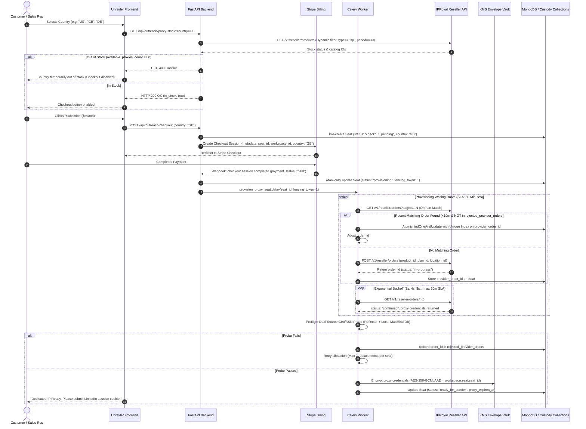

# Unravler.io — Hardened Automated IP Allocation & Proxy Lifecycle Plan
**Technical Specification & Production Implementation Standard**  
*Document Version: 3.2.0 (Audited Canonical Standard) | Date: October 2026*  
*Canonical Reference: Aligned with `DOC_1_USER_LIFECYCLE_AND_IP_PROVISIONING.md`*

---

## Status Legend & Verification Matrix

* `[IMPLEMENTED & TESTED]`: Built in repository, verified with unit/integration tests.
* `[IMPLEMENTED UNTESTED]`: Built in repository, awaiting live production verification with third-party APIs.
* `[PLANNED]`: Architecturally specified; scheduled for deployment.
* `[ASSUMPTION]`: Operational target to be benchmarked during the canary fleet and closed pilot runs.

---

## 1. Architectural Principles & Threat Posture

1. **Zero Country Substitution `[IMPLEMENTED & TESTED]`**:
   The platform will **never** silently default an IP country (e.g. falling back to `"US"`). The target operating country must be explicitly selected by the user and verified against live upstream stock before checkout is unlocked. If out of stock, checkout is blocked with an explicit HTTP 409 notice.
2. **Payment-Gated Provisioning `[IMPLEMENTED & TESTED]`**:
   Upstream provider orders are never triggered on checkout intent. Provisioning is triggered **only** after payment settles (`payment_status == "paid"` on `checkout.session.completed` or `status == "active"` on `invoice.payment_succeeded`).
3. **Asynchronous Waiting Room Protocol `[PLANNED]`**:
   Upstream provider orders are inherently asynchronous. The platform communicates via dynamic catalog IDs (`product_id`, `product_plan_id`, `product_location_id`), enforces client-side orphan reconciliation with atomic database claims, and transitions orders through a state-fenced background worker.
4. **Fail-Closed Security Posture `[IMPLEMENTED & TESTED]`**:
   Under no circumstances does the application automate, capture, or relay 2FA codes, email PINs, or CAPTCHA challenges. On challenge detection, tasks immediately halt, campaigns transition to `reauth_required`, and the user is directed to resolve the challenge natively in their own browser.
5. **Immediate Cookie Purge at Churn `[IMPLEMENTED & TESTED]`**:
   When a subscription lapses or is cancelled, all plaintext and ciphertext session cookies (`li_at`/`JSESSIONID`) are permanently deleted from database and memory stores.
6. **Provider Reality & Inverted Float Reserve `[PLANNED]`**:
   Completed provider orders cannot be cancelled upstream. Non-renewal relies entirely on natural lease expiration (`auto_renew = false`). Active extensions are managed via an idempotent daily Celery Beat cron guarded by an **inverted float reserve** that protects existing paying subscribers over new acquisitions.

---

## 2. Canonical State Machine & Unified Transition Table

To eliminate all contradictions between seat and sender states, this single transition table governs ownership, triggers, guards, and side effects across the system:

| Entity | Current State | Trigger / Event | Guard Condition | Target State | Operational Side Effects |
| :--- | :--- | :--- | :--- | :--- | :--- |
| **Seat** | `checkout_pending` | `checkout.session.completed` | `payment_status == "paid"` | `provisioning` | Insert durable intent; enqueue `provision_proxy_seat` |
| **Seat** | `checkout_pending` | Stripe session expired | Expiration webhook / 24h timeout | `expired` | Hard-delete pending record; free temporary locks |
| **Seat** | `provisioning` | Order polling exceeds 120s | Polling elapsed < 30m SLA | `provisioning_delayed` | Handoff UI to async notification; keep background polling |
| **Seat** | `provisioning` / `provisioning_delayed` | Order confirmed & probe passed | Exit IP matches country & latency < 8s | `ready_for_sender` | Encrypt credentials; notify user to link LinkedIn session |
| **Seat** | `provisioning` / `provisioning_delayed` | Provider error / SLA breach | Retries exhausted (>2 replacements) | `provisioning_failed` | Auto-refund via Stripe; cancel seat; alert ops |
| **Seat** | `ready_for_sender` | Session cookie verified on `/me` | HTTP 200 returned via proxy tunnel | `active` | Transition sender to `connected`; unlock wizard |
| **Seat** | `active` | `invoice.payment_failed` | Stripe payment failure webhook | `paused_payment` | Halt campaigns; email payment link; start 14d dunning |
| **Seat** | `paused_payment` | `invoice.payment_succeeded` | Dunning cleared within 14 days | `active` | Resume campaigns |
| **Seat** | `paused_payment` | Dunning window expired (14d) | `customer.subscription.deleted` | `lapsed` | Mark terminal; do not prolong proxy; **hard-delete cookies** |
| **Seat** | `active` | User cancels subscription | `cancel_at_period_end == true` | `active` | Keep running until billing cycle ends; skip cron extensions |
| **Seat** | `active` | Period ends after cancellation | Stripe subscription deleted | `cancelled` | Mark terminal; do not prolong proxy; **hard-delete cookies** |
| **Sender** | `connected` | HTTP 401 / Auth Challenge | Session invalidated or challenge URL | `reauth_required` | Halt tasks; alert user to log in via browser |
| **Sender** | `connected` | HTTP 429 / 999 Rate Limit | Rate limit response from Voyager API | `rate_limited` | Back off worker 24h; defer scheduled tasks |
| **Sender** | `connected` | 3 consecutive proxy timeouts | Proxy unreachable > 15s | `proxy_degraded` | Pause queue; run diagnostic probe |
| **Sender** | `connected` / `any` | Permanent restriction notice | Account restriction verified | `paused_restricted` | **Trip circuit breaker; freeze all sender tasks; require operator review** |
| **Sender** | `reauth_required` | User submits fresh cookie | HTTP 200 on `/me` via proxy | `connected` | Re-encrypt cookie; resume under warmup schedule |
| **Sender** | `paused_restricted` | Operator clears after review | Operator explicitly signs resolution | `connected` | Resume under conservative warmup schedule |

---

## 3. End-to-End System Sequence



---

## 4. Subsystem Specifications

### A. Pre-Checkout Stock Gate & Dynamic Catalog Parser `[IMPLEMENTED & TESTED]`
* **Endpoint**: `GET /api/outreach/proxy-stock?country={code}`
* **Upstream Endpoint**: `https://apid.iproyal.com/v1/reseller/products`
* **Parsing Logic**:
  1. Iterate catalog products and identify entity where `type == "isp"`.
  2. Locate target plan where `period_days == 30` (or `days == 30`) and verify `min_quantity <= 1`.
  3. Match target country using ISO-3166 alpha-2 format against location entities.
  4. Assert `available_proxies_count > 0` and `out_of_stock == false`.
  5. Dynamically capture `product_id`, `product_plan_id`, and `product_location_id`.
* **Zero Substitution Rule**: If unavailable, return HTTP 409 Conflict. **No country fallback is permitted.**

### B. Pre-Creation & Webhook Settlement `[IMPLEMENTED & TESTED]`
* **Pre-Creation at Checkout**: When checkout is initiated, write to MongoDB:
  ```json
  {
    "_id": "seat_6711a8b...",
    "workspace_id": "ws_123...",
    "country": "GB",
    "status": "checkout_pending",
    "fencing_token": 0,
    "created_at": "2026-10-18T16:00:00Z"
  }
  ```
* **Stripe Metadata**: Pass `seat_id` in `client_reference_id` and metadata.
* **Webhook Settlement**:
  Listen for `checkout.session.completed` and `checkout.session.async_payment_succeeded`.
  * Assert `payment_status == "paid"`.
  * Atomically transition `seat_id` from `checkout_pending` $\rightarrow$ `provisioning`.
  * Dispatch `provision_proxy_seat.delay(seat_id, fencing_token=1)`.

### C. Asynchronous Waiting Room, Orphan Reconciliation & SLA `[PLANNED]`
* **SLA & Polling Strategy**:
  * Polling runs with exponential backoff: 2s, 4s, 8s, 16s... up to 30 minutes maximum SLA.
  * If polling exceeds 120 seconds, seat transitions to `provisioning_delayed`. The UI gracefully updates: *"Carrier allocation in progress. We will email you once ready."*
* **Orphan Reconciliation Guard**:
  Before placing an order, query `GET /v1/reseller/orders` (paginating through all open pages).
  * Check for orders matching `product_location_id` and `plan_id` created within the last 10 minutes.
  * **Filter**: Must **NOT** exist in `rejected_provider_orders`.
  * **Atomic Claim**: If an unassigned match is found, attempt atomic claim via `findOneAndUpdate`:
    ```python
    claimed = db.outreach_seats.find_one_and_update(
        {"_id": seat_id, "provider_order_id": None},
        {"$set": {"provider_order_id": candidate_order_id, "fencing_token": fencing_token}}
    )
    ```
  * A MongoDB unique index (`unique=True, sparse=True`) on `provider_order_id` ensures no two seats can ever claim the same order.
* **Replacement Cap & Timeout Refund**:
  * Maximum 2 replacements per seat (`MAX_REPLACEMENTS_PER_SEAT = 2`).
  * If provider explicitly cancels or 30-minute SLA breaches:
    1. Seat transitions to `provisioning_failed`.
    2. Automatic refund via `stripe.Refund.create(charge=charge_id)`.
    3. Subscription cancelled.
    4. Location flagged for ops review.
  * If an order confirms after SLA cancellation, write credentials to `unclaimed_proxy_inventory` for adoption by the next matching user.

### D. Preflight Dual-Source Probe & Local MaxMind Lookup `[PLANNED]`
Before marking a proxy `ready_for_sender`, the worker tests the tunnel:
1. **Exit IP Verification**:
   Worker makes an HTTPS call through the proxy tunnel to an owned reflector endpoint (`https://api.ipify.org` or backend reflector).
   * **Assertion**: Returned IP must **strictly match** the IP provided in the provider order response.
2. **Local Geolocation & ASN Lookup**:
   Worker queries a **locally hosted, commercially licensed MaxMind GeoIP2 / GeoLite2 database file** mounted on the host.
   * **Assertion**: Exit country matches user's chosen country code.
   * **Latency**: Round-trip time < 8,000ms.
3. **Pilot ASN Stance**:
   During the closed pilot, ISP/ASN verification runs in **`log_only` mode** to record real ISP names without dropping edge providers prematurely.
4. **Rejection Handling**:
   If probe fails:
   * Write `order_id` to `rejected_provider_orders`.
   * Increment `seat.replacement_count`.
   * Retry up to the 2-replacement limit.

### E. KMS Envelope Encryption Architecture `[IMPLEMENTED & TESTED]`
* **Threat Model Reality**:
  KMS envelope encryption protects cold storage dumps, database backups, compromised database credentials, and cross-workspace ciphertext injection. It does **not** protect against an attacker with root RCE on the live host who has active IAM permissions to call `kms:Decrypt`. Host security relies on IMDSv2 enforcement (`HttpTokens=required`, `HttpPutResponseHopLimit=1`) and container capability drops (`cap_drop: ALL`).
* **Cryptographic Keys & Distinct AAD**:
  1. AWS KMS `GenerateDataKey` per workspace yields Data Encryption Key (DEK).
  2. Payload encrypted using **AES-256-GCM**.
  3. **Proxy Credentials AAD**: `AAD = f"{workspace_id}:seat:{seat_id}"`.
  4. **Session Cookie AAD**: `AAD = f"{workspace_id}:sender:{sender_id}"`.
  5. Store EDK + Nonce + Ciphertext + Tag in DB.

### F. Network-Level Egress Default-Deny `[PLANNED]`
To eliminate accidental direct IP leaks:
1. Outreach worker containers execute on an **internal Docker network (`internal: true`)** with no default internet gateway and no NAT egress.
2. Outbound traffic must route through a dedicated local forward proxy gateway (Envoy sidecar).
3. The sidecar restricts outbound connections exclusively to the upstream proxy IPs assigned to active seats.
4. **Startup Canary Self-Test**: Worker executes a direct HTTP call to an external canary target without proxy configuration. If the request succeeds, **the container immediately halts startup**, proving direct egress is blocked.

---

## 5. Lifecycle Maintenance: Renewal, Churn & Resubscription

### A. The Daily Extension Cron & Inverted Float Reserve `[PLANNED]`
* **Schedule**: Daily at 03:00 UTC via Celery Beat.
* **Target Query**: Seats where `status == "active"`, `cancel_at_period_end == false`, and `proxy_expires_at <= now() + 3 days`.
* **The Inverted Float Reserve Gate**:
  * Upstream balance is checked via `GET /v1/reseller/balance`.
  * Calculate required reserve:
    $$\text{Required Float Reserve} = (\text{Seats Expiring in Next 7 Days} \times \text{Unit Cost}) + \$30.00$$
  * **Rule**: If `balance < Required Float Reserve + Unit Cost`, **block new Stripe checkouts** in the frontend (`status: "capacity_paused"`). Existing paying customers are prioritized over new signups.
* **Two-Phase Idempotent Extension Protocol**:
  1. Mark seat `extension_state = "in_flight"` with current billing cycle ID.
  2. Call `POST /v1/reseller/orders/{id}/prolong`.
  3. Read back updated `expire_date` from `GET /v1/reseller/orders/{id}`.
  4. Update `proxy_expires_at` and set `extension_state = "settled"`.
* **Failed Extension Recovery**:
  * If extension fails: Retry hourly.
  * At $T - 48\text{h}$: Alert platform operator via PagerDuty/Slack.
  * At $T - 24\text{h}$: System automatically provisions a **replacement IP** at Unravler's cost, transitions sender to `reauth_required`, alerts user to re-link session, and resumes under the warmup schedule.

### B. 14-Day Dunning Window & Cookie Purge `[PLANNED]`
* When a payment fails (`invoice.payment_failed`):
  * Seat transitions to `paused_payment`.
  * Campaigns pause; outbound tasks halt.
  * **14-Day Grace Window**: Aligned with Stripe Smart Retries (up to 8 attempts over 14 days). Proxy lease remains funded (having been extended on Day 27). Session cookies are preserved in KMS vault.
* When payment recovers (`invoice.payment_succeeded`):
  * Seat transitions back to `active`. Campaigns resume.
* When subscription cancels or dunning expires (`customer.subscription.deleted`):
  * Seat transitions to `lapsed`.
  * Upstream proxy expires naturally (`auto_renew = false`).
  * **Mandatory Security Action**: The system immediately **hard-deletes all stored session cookies (`li_at`/`JSESSIONID`)** from the database and KMS vault.

### C. Resubscription Protocol (After Lease Expiry) `[PLANNED]`
* If a customer resubscribes after their previous proxy lease has expired (`now > proxy_expires_at`), the previous IP cannot be recovered (the provider returned it to the global pool).
* Processed as a **brand new seat**:
  1. Live stock check executed for target country.
  2. Customer completes checkout.
  3. Fresh dedicated static residential IP allocated via waiting room.
  4. User submits fresh session cookie.
  5. Account enters canonical **warmup schedule** (10 actions/day for first 14 days, max 15% weekly increases contingent on $\ge 35\%$ connection acceptance rate).

---

## 6. Incident Handling: Security Checkpoints (Fail-Closed Standard)

```
 [Challenge Detected: HTTP 401 / Checkpoint URL]
                     │
                     ▼
 [Atomic Transition: SenderStatus.reauth_required]
                     │
                     ▼
 [Halt Execution: Kill in-flight tasks & revoke queue lease]
                     │
                     ▼
 [Notify User: Send Email + Dashboard Alert]
   "LinkedIn has issued a security challenge. 
    Please log in via your regular browser to resolve it."
                     │
                     ▼
 [User Resolves in Browser & Submits New Cookie]
                     │
                     ▼
 [Preflight Validation Probe: HTTP 200 on /me]
                     │
                     ▼
 [Resume Campaigns under Conservative Warmup Ramp]
```

### Inviolable Prohibitions:
* ❌ Never render an in-app modal asking the user to enter their SMS/email 2FA code.
* ❌ Never submit 2FA security codes through backend HTTP clients or headless workers.
* ❌ Never integrate automated CAPTCHA-solving services (2Captcha, Anti-Captcha).

---

## 7. Operational Runbook & Circuit Breakers

1. **Balance Alerting**:
   * Critical alert dispatched if float balance drops below \$30.00.
   * Auto-lock on new checkouts engages if balance drops below `Required Float Reserve`.
2. **Orphan Inventory Drainage**:
   * Celery periodic job runs every 4 hours to sweep `unclaimed_proxy_inventory`.
   * Unclaimed IPs are prioritized for the next matching country checkout before placing new upstream orders.
3. **Audit Logging**:
   * All state transitions, IP allocations, order IDs, preflight probe outputs, and cookie purges are written to an append-only collection (`outreach_audit_events`).
