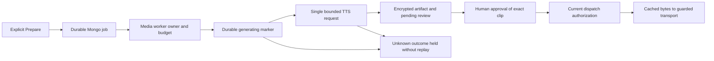

# Unravler.io — Offline Campaign Voice Preparation
Version: 2.11.0 | Date: 2026-10-03 | Status: Local implementation; generation and live sending disabled by default

## Result and scope
Campaign voice recordings are prepared through durable MongoDB jobs on the media queue before content review. The campaign executor only loads the exact reviewed recording; it cannot generate audio. A lost worker or ambiguous paid provider response cannot silently repeat generation.

This is the tenth local architecture slice. No commit, push, deployment, production grant, provider purchase, real TTS request or live-action enablement was performed. Tests use disposable loopback MongoDB/Redis, fake credentials, MockTransport and a local TCP provider. Earlier slices and their operational limitations remain applicable.

## Preparation and review contract
1. An identified user with outreach management permission explicitly prepares the current lead step. A current paid entitlement, finished bounded script, real configured voice profile, working encryption and the separate generation flag are required to queue generation. Preparing content never grants sender execution or launches/resumes a campaign.
2. The workspace guard and snapshot/majority transaction bind the lead/enrollment, recipient, sender/generation, campaign revision, immutable sequence identity, voice profile identity and generation policy. Existing authorities are fenced; participating voice profile insertion, assignment and deletion writes share the guard. Unsupported transactions deny; older/raw writers require drain.
3. The publisher reserves a due timestamp and sends only job/workspace IDs to Celery. Broker failure leaves the MongoDB job available. Workers claim an exact owner, reserve a daily workspace budget and persist the `generating` boundary before any potentially billable request. HTTP runs outside transaction retries.
4. A bounded response is validated and converted to PCM WAV. The final transaction rechecks the current context/owner/lease, stores encrypted audio with a digest and generation identity, creates the pending exact-content review, and saves the job receipt together. Changed context discards the received recording. A failed final commit leaves uncertainty; redelivery never calls TTS again.
5. A human reviews the current script, recipient and cached clip. Approval lasts at most 24 hours and binds the recording generation as well as its digest. Replacing a recording with identical bytes still requires a fresh review. Playback acknowledgement is a human assertion, not measured listening.
6. Sequence dispatch requires the current base binding to own the artifact. Every rebuilt approval must equal the approval captured for the actual transport, including the final transaction callback. A recipient/context change cannot reuse another approved record even when both versions have prior approvals. The LinkedIn uploader receives the exact cached bytes only after all existing execution guards pass.

## Policy and recovery
The versioned policy fixes `eleven_turbo_v2_5`, `pcm_16000`, mono 16-bit PCM at 16 kHz, stability 0.5 and similarity boost 0.8. Scripts are limited to 1,000 finished characters, recordings to 60 seconds, and each workspace to 20 generation reservations / 20,000 script characters per UTC day. Potential paid calls remain conservatively charged against the local budget. This is an application ceiling, not proof of vendor billing or account credits.

The provider adapter makes one request to the fixed ElevenLabs TTS endpoint, rejects redirects, ignores environment proxy settings, limits the response stream and uses a 30-second overall deadline. Non-200, malformed, empty, oversized and interrupted responses remain held once the possible-call marker exists; no mock fallback or automatic retry is available. The current API shape was checked against [ElevenLabs TTS documentation](https://elevenlabs.io/docs/api-reference/text-to-speech/convert). Actual account/model/output-format availability and LinkedIn media compatibility remain unverified live dependencies.

Expired `claimed` jobs can be recovered because no generation boundary was crossed. Expired `generating` jobs become `held_outcome` and lose their script snapshot. A saved prepared receipt is reused without HTTP. Expired/corrupt recordings require another explicit Prepare and fresh review. Held jobs cannot be reset by repeated Prepare, worker redelivery or daily budget rollover; this slice adds no operator replay/resolution UI or vendor billing reconciliation.

Recovery ordering uses separate due timestamps and bounded backoff. A stopped workspace can receive only an exact existing-job scheduling timestamp change through private erasure control; no upsert, content, owner, status or permission change is allowed there. Closed jobs remain stopped/held for drained retention review. This publisher is itself a writer that must be drained before purge.

## Workspace and erasure integration
Voice Studio database reads and mutations now use the active workspace only. Unknown legacy personal/shared ownership is not adopted automatically. Profile assignment increments identity revision; provider deletion failure preserves the local record, and local deletion cannot remove a concurrently replaced profile.

Outreach erasure includes generation jobs and daily budgets. Stopping cancels queued/claimed jobs and removes their binding snapshots; generating/held work remains ambiguous until drained review. Purge retains only minimal uncertainty metadata and scrubs script/audio/credentials. Encrypted prepared artifacts expire after 24 hours with a TTL index; generation jobs have no TTL that could erase possible paid-call evidence. Closed-workspace recovery cannot reopen the tenant.

## Remaining work and rollout
Legacy Voice Studio clone, sample preview and provider deletion remain synchronous vendor workflows. They are not covered by the new durable campaign TTS protocol. Consent/ownership attestation, provider-format/uploader validation and durable lifecycle/custody redesign for those workflows remain required before a generation pilot.

The media queue is scheduling separation. API/media workers still share deployment credentials and database access; it does not establish process, kernel egress or workload-identity isolation. Fernet is current storage, not KMS envelope custody. Current routing, restore-epoch fencing, remote-copy/backup retention, purchased IPRoyal sender verification and mailbox operation remain outstanding.

Before rollout:
- Keep `OUTREACH_VOICE_PREPARATION_ENABLED=false` and `OUTREACH_LIVE_ACTIONS_ENABLED=false` in both Compose configurations. A separate authorized generation pilot may consume vendor credits while sending remains disabled; enabling generation is not authorization to send.
- Drain older API, media, sequence, connection, inbox/mailbox, suppression and erasure writers. Verify actual replica-set transactions and all required indexes; index-creation warnings alone are insufficient evidence.
- Inspect existing recordings/reviews/jobs. Old mock, MP3, corrupt, expired or context-incompatible artifacts cannot dispatch. Preserve unknown jobs and earlier deduplication/evidence. Explicitly prepare current WAV recordings and obtain fresh generation-bound reviews rather than editing legacy approvals into validity.
- Verify credential/workload identity, process/kernel proxy-only egress and restore fencing before purchased-seat/mailbox pilot checks or a separate live-action release decision. Keep manual verified-invoice provisioning; automatic billing/proxy ordering remains deferred.

## Code and evidence
Core: `outreach/core/voice_preparation.py`, `voice_policy.py`, `voice_provider.py`, `voice_artifacts.py`, `content_approval.py`, `dispatch_authority.py`, `erasure.py`. Entry points: `outreach/api/content_approvals.py`, `outreach/api/voice.py`, `outreach/tasks/sequence_executor.py`, `celery_workers/tasks/voice_preparation.py`, `celery_workers/celery_app.py`, `db/indexes.py` and Compose. UI: `frontend/src/outreach/pages/OutreachContentReview.js`.

New tests cover generation deduplication, concurrent workers/budgets, API non-calls, exact encrypted clip reuse, workspace/profile boundaries, invalid audio, final transaction projection failure, live flags, erasure and fair recovery. Disposable replica-set tests additionally order context changes against authority reads and prove final recipient swaps deny transport even with pre-existing approvals for both recipients. Four SIGKILL/real Redis redelivery cases use the production generation adapter over loopback TCP: after claim, before HTTP, after response, and after committed preparation.

Verification: 830 distinct outreach backend checks pass: 786 in the final main suite, 5 broker/outbox drills, 35 physical provider crash cases and 4 new voice crash cases. Twenty account/auth companions pass in the same 806-test main run; the 44 opt-in drill cases skipped there were executed separately. This slice adds 59 outreach checks, including 17 disposable real MongoDB cases and 4 real Redis/SIGKILL voice cases. The actual index migration verifies generation-job recovery/publication indexes, absence of job TTL and the artifact expiry TTL. The full 44-case drill matrix passed; broker/voice drills were repeated after the final binding correction, with affected email token/receipt drills checked again separately.

Statement coverage across the five voice modules is 97% (policy 93%, preparation 96%, worker 97%, artifact/provider 100%). All 86 frontend tests (80 outreach and 6 deletion-status tests) and the production frontend build pass, with existing dependency/Tailwind/source-map/bundle warnings. Python compilation, medium/high Bandit, whitespace checks and both Compose configurations pass. Independent Python review passed 85 focused cases, including all 17 real MongoDB voice cases, and approved the bounded local slice with no remaining high/critical findings. Ruff is unavailable in the local environment; no Ruff pass is claimed. Owned loopback MongoDB/Redis services were stopped and their ports verified closed; no temporary test databases remained.

Earlier evidence: [Erasure and retention](UNRAVLER_IO_ERASURE_AND_RETENTION_RELEASE.md), [Suppression ordering](UNRAVLER_IO_SUPPRESSION_ORDERING_RELEASE.md), [Transactional dispatch authority](UNRAVLER_IO_ATOMIC_DISPATCH_AUTHORITY_RELEASE.md), [Physical crash recovery](UNRAVLER_IO_PHYSICAL_CRASH_RECOVERY_RELEASE.md). Specifications and Desktop mirrors are v2.11.0; originals are backed up at `/tmp/unravler-docs-before-v2-11`.
